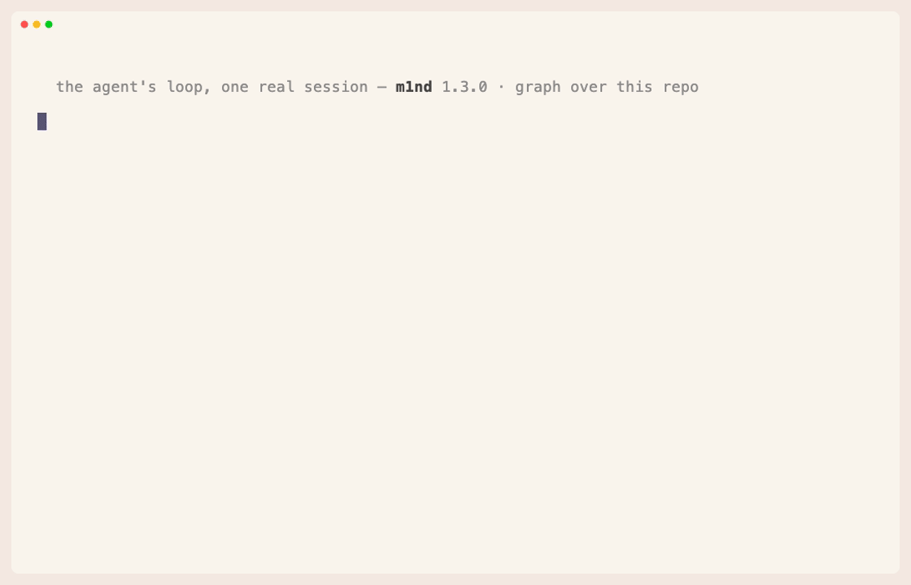

<p align="center">
  
</p>

# Give your coding agent a map it can check

**m1nd is a local code graph and evidence-linked memory for MCP coding agents.** Find connected code, inspect the impact of a change, and carry verified findings into the next session. Answers include trust signals and explicit gaps so your agent knows what still needs checking.

Built for developers working across unfamiliar repositories, multi-file changes, or repeated agent sessions. Use your existing MCP host; the runtime is Rust and the license is MIT.

<p align="center">
  <a href="https://www.npmjs.com/package/@maxkle1nz/m1nd"></a>
  <a href="https://github.com/maxkle1nz/m1nd/actions/workflows/ci.yml"></a>
  <a href="LICENSE"></a>
</p>

[Get started](#get-started) · [Workflows](#what-to-try-next) · [Limits](#what-it-does-and-does-not-prove) · [Documentation](https://m1nd.world/wiki/)

## Why add it to your agent?

- **Start with the repo's structure.** `north` combines task context, bounded source excerpts, binding trust, prior memory, and a suggested next move. `seek` finds candidates; `impact` helps inspect their neighbors before editing.
- **Keep findings attached to code.** `memorize` stores claims with evidence paths and provenance. The next session can recall them and check whether they still apply.
- **Share context across agents.** A served local owner can share one graph with attached clients. Presence and overlap warnings help agents coordinate; they are advisory, not locks.
- **See uncertainty.** `reverify`, `abstain`, and `insufficient_evidence` are useful results. A graph connection is a reason to inspect code, not proof that a change is safe.

The graph and memory live on your machine. m1nd does not require an LLM API key for graph queries. Installation, updates, optional model downloads, and network-backed document providers can use the network or transmit documents to a configured endpoint; your MCP host has its own data policy.

## Get started

<!-- Keep the former setup anchor working for existing links. -->
<a id="sixty-seconds"></a>
<a id="quick-start"></a>

**Version matters:** this branch contains the `1.6.4` source line. At this documentation refresh, the latest published release is `1.6.3`. The automatic isolated first-workspace path below is a **source-preview feature** until `1.6.4` is published. Check [releases](https://github.com/maxkle1nz/m1nd/releases) for shipped versions.

### Published 1.6.3: install, prepare, connect

You need **Node.js 18+**, an MCP host, and a repository. First [install the signed native 1.6.3 artifact](docs/INSTALL-1.6.3.md); that guide uses `cosign` and an exact release URL. The prebuilt 1.6.3 release covers Linux x86_64 and macOS x86_64/ARM64. Run this POSIX-shell recipe from the repository you want to use; it deliberately pins the wrapper:

```bash
# After the signed installation guide, select the exact native binary.
export M1ND_BINARY="$HOME/.local/share/m1nd/versions/1.6.3/m1nd-mcp"
"$M1ND_BINARY" --version

# Confirm this binary reports native 1.6.3 before continuing.
# Bind the human ceremony and host to the same explicit repository runtime.
export M1ND_RUNTIME_DIR="$(pwd -P)/.m1nd"
# Run this yourself in a terminal, once for an empty runtime.
npx -y @maxkle1nz/m1nd@1.6.3 init --birth . --binary "$M1ND_BINARY"

# Preview your host configuration before applying it.
npx -y @maxkle1nz/m1nd@1.6.3 hosts plan --host claude --project . --binary "$M1ND_BINARY"
npx -y @maxkle1nz/m1nd@1.6.3 hosts apply --host claude --project . --binary "$M1ND_BINARY" --yes
```

Replace `claude` with your host, such as `codex` or `cursor`. Follow the printed instructions: some host-managed configuration and hooks are **printed for you to install**, not written automatically. Restart or reconnect the host after configuration changes. See the [host integration matrix](docs/HOST-INTEGRATION-MATRIX.md) for host-specific behavior.

Before reconnecting, add `M1ND_RUNTIME_DIR` to the generated MCP server environment with the **same absolute path** printed by `echo "$M1ND_RUNTIME_DIR"`. Keep the generated `M1ND_WORKSPACE_ROOT`. `hosts apply` does not add the runtime selector for you; without it, a host launched elsewhere can open a different graph.

This recipe targets native **1.6.3**. Pinning the npm wrapper alone does not pin `update apply`; that command follows the registry channel and is intentionally excluded here. If the selected binary reports a different version, check that release's setup contract before continuing. The birth command is a human terminal step, not an agent tool call. Its receipt must report `brain: "owner_bound_graph"`, the intended `born_root`, the exact runtime in `store_dir`, and `node_count > 0`. If it refuses, follow its diagnostic rather than replacing another runtime or forcing `ingest`. For source builds, use the separate contributor path below.

### Your first useful result

Ask your connected agent:

> Use m1nd to orient on this repository. Find where configuration is loaded, show the relevant source locations, and tell me what you still need to verify. Do not edit files.

The agent should call `north` first, then use `seek` and source inspection as needed. **Success means the response covers the correct repository and points to real code you can open.** A `reverify` verdict can be normal on an uncalibrated graph: inspect the evidence. A missing graph or wrong-workspace binding needs recovery; an empty result may need a different query.

[Quick-start troubleshooting](docs/wiki/src/tutorials/quickstart.md) covers missing binaries, host configuration, and binding errors. [Your first query](docs/wiki/src/tutorials/first-query.md) shows the actual MCP calls.

### Source preview: isolated first workspace (1.6.4)

For contributors testing the current source, use the matching wrapper and native runtime, rather than combining this checkout's wrapper with a published older binary. Use a clean shell without the published recipe's runtime override; the source CLI selects an external private cache:

```bash
git clone https://github.com/maxkle1nz/m1nd.git
cd m1nd
cargo build --release -p m1nd-mcp
node npm/bin/m1nd.js agent first-minute --repo /absolute/path/to/your/repo \
  --binary ./target/release/m1nd-mcp --query "map this repo" --json
```

Follow [the source-preview recipe](docs/AGENT-AUTONOMY.md#public-npm-cli-and-process-status) for selecting that binary and a private runtime. `agent first-minute` discovers a covering served owner first; otherwise the current source can prepare an isolated graph for the exact granted repo. It cannot mint a shared brain, move a binding, or bypass the generic ingest floor. [The contributor development kit](docs/DEVELOPMENT.md) provides checkout-private state for development.

## What to try next

| Task | Start with | Check before acting |
|---|---|---|
| Understand unfamiliar code | `north` → `seek` → `surgical_context` | Open the returned source; check the workspace binding and trust envelope. |
| Plan a cross-file change | `impact` and `why` on a returned node | Confirm callers and imports with source/compiler tooling; unresolved edges are gaps. |
| Resume an investigation | `north`, `boot_memory`, or `trail_resume` | Review evidence, author, age, and any stale flags before reusing a claim. |
| Preserve a verified finding | `memorize` with repo-relative evidence paths | Store what you actually verified, not an agent's untested conclusion. |
| Coordinate parallel agents | One served owner and attached clients | Treat overlap notices as a request to coordinate; they do not prevent edits. |

See [worked examples](EXAMPLES.md), [use cases](docs/use-cases.md), and the [tool reference](docs/wiki/src/api-reference/overview.md). The default tool menu is deliberately small. `help` discovers the full registry; `M1ND_TOOL_TIER=full` expands the advertised menu. For graph change tracking, source builds also offer `M1ND_TOOL_TIER=investigate`: the core plus five session-local snapshot tools. See the [beginner and advanced recipe](docs/GRAPH-CHANGE-TRACKING.md). Source-preview graph-linked search also preserves canonical node IDs for single-file ingest roots; ambiguous file mappings are omitted. A listed or callable tool may still require authority the current session does not have.

## What it does and does not prove

- **Best fit:** structural navigation, change preparation, and continuity across repeated work. For a tiny edit or exact string lookup, a file read or `rg` may be enough.
- **Extraction is approximate.** Language support varies, macro-generated and dynamic references can be missed, and external imports may remain unresolved. A graph is not a compiler's semantic model.
- **Trust is conditional.** Uncalibrated retrieval can cap at `reverify`; prediction can abstain. Run the actual compiler, tests, and runtime checks needed for your change. Source calibration keeps [ledger seconds and receipt milliseconds distinct](docs/LEARNING-TIME-UNITS.md); that clock correction does not establish statistical quality.
- **Writes have extra boundaries.** Preview/commit tools, proof permits, and authority checks are separate from read-only retrieval. Graph/static verification is not a substitute for executed tests. See [write reference](docs/wiki/src/api-reference/lifecycle.md).
- **Local does not mean authenticated.** The served owner refuses non-loopback binds; loopback alone does not authenticate other local processes. See [deployment](docs/deployment.md) and [security](SECURITY.md).
- **Advanced capabilities are not setup prerequisites.** Document adapters, structural heuristics, transplant, missions, and hardware-backed authority have their own limits. PRDs describe design intent and are not evidence that a release supports every path.

## Shared context, one local owner

After a person has prepared the repository's runtime, use the exact `store_dir` from that receipt (shown below as `/absolute/path/to/project/.m1nd`) to start one owner and attach clients to it:

```bash
export M1ND_BINARY="$HOME/.local/share/m1nd/versions/1.6.3/m1nd-mcp"
"$M1ND_BINARY" --serve --no-gui --port 1337 --runtime-dir /absolute/path/to/project/.m1nd
# Run each client from the repository it should query:
"$M1ND_BINARY" --attach auto --stdio
```

The owner holds the graph; attached clients do not load another copy or take its writer lease. Auto-discovery must find an owner that already covers the caller's repository. It does not authorize a new shared brain. The served owner can also render the web UI. Follow [deployment](docs/deployment.md) before configuring multiple repositories or persistent startup.

## Evidence you can inspect

Prefer a reproduction and its boundary to an unqualified speed or savings claim:

- [Benchmark methodology](docs/benchmarks/README.md) and [wiki evidence guide](docs/wiki/src/benchmarks.md) distinguish synthetic engine timings, historical corpus runs, and end-to-end product measurements. These are not general ROI guarantees.
- [Persistence integration tests](m1nd-mcp/tests/persist_runtime_root.rs) exercise real stdio processes across clean boots and interrupted runs.
- [Agent autonomy tests and contract](docs/AGENT-AUTONOMY.md) describe exactly which automatic startup, identity, and shutdown paths the source implements.
- [Test portfolio](docs/TEST-PORTFOLIO.md) explains scoped PR gates and the full integration matrix. A current source change is not automatically a published release.

The demo below is a historical recording of `m1nd-mcp 1.4.0`, not the current installation flow or a performance promise:

<p align="center">
  
</p>

## Language coverage

Dedicated extractors cover more than twenty languages: Python and TypeScript through Elixir, Haskell and Zig, routed by file extension in `m1nd-ingest`. The table records call-edge and cross-file import extraction exercised in a polyglot ingest. It is not a claim of complete or compiler-grade resolution; qualified Rust calls, macros, and dynamic references can lose precision.

| Language | `calls` | cross-file imports |
|---|:---:|:---:|
| Rust | ✅ | ✅ |
| Python | ✅ | ✅ |
| JavaScript / TypeScript | ✅ | ✅ |
| Go | ✅ | ✅ |
| Java | ✅ | ✅ |
| C / C++ | ✅ | ✅ |
| Kotlin | ✅ | ✅ |
| PHP | ✅ | ✅ |
| Scala | ✅ | ✅ |
| Ruby | ⏳ | ✅ |
| C# | ✅ | namespaces don't map 1:1 to files |
| Swift | ✅ | not yet |

Unresolvable imports (external packages, stdlib, system headers) are left unresolved rather than guessed. Everything else falls back to a generic extractor with `contains` edges only.

## Architecture and deeper documentation

The Cargo workspace has six crates: `m1nd-core` (graph engine), `m1nd-ingest` (extraction), `m1nd-mcp` (MCP owner and runtime), `m1nd-control`, `m1nd-runnerd` (execution lane), and `m1nd-openclaw` (bridge). The web UI and npm wrapper live outside the Rust workspace.

- [Documentation index](docs/README.md): choose a task, then a guide
- [Wiki](https://m1nd.world/wiki/): tutorials, concepts, and API reference
- [Agent installation guide](llms-install.md): setup instructions for coding agents
- [Changelog](CHANGELOG.md): release history
- [Contributing](CONTRIBUTING.md): development and verification

## Translations

[Português](i18n/README.pt-BR.md) · [Español](i18n/README.es.md) · [Italiano](i18n/README.it.md) · [Français](i18n/README.fr.md) · [Deutsch](i18n/README.de.md) · [中文](i18n/README.zh.md) · [日本語](i18n/README.ja.md)

Translations have not been refreshed with this English revision and may contain outdated setup or capability claims. Use this English README for current instructions.

## License

MIT. Your graph is derived from your code; memory files remain on disk. See [LICENSE](LICENSE).
