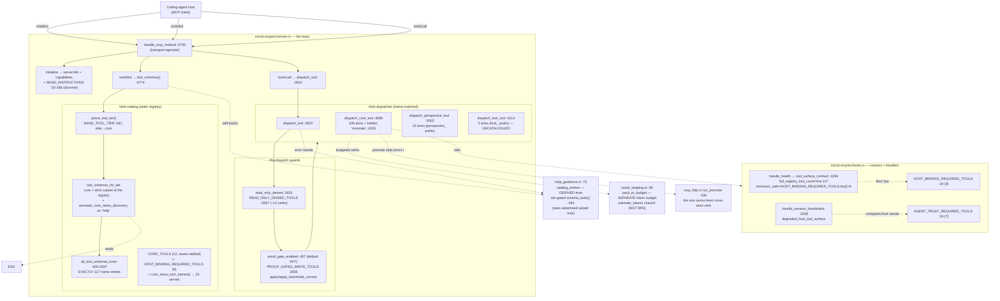
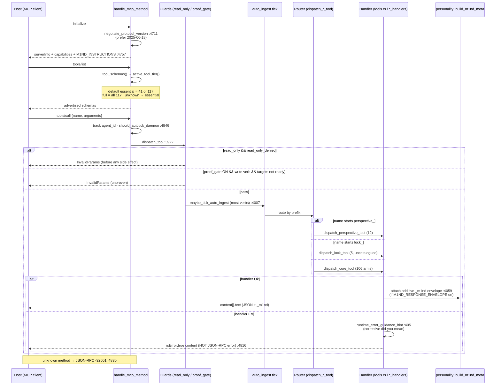
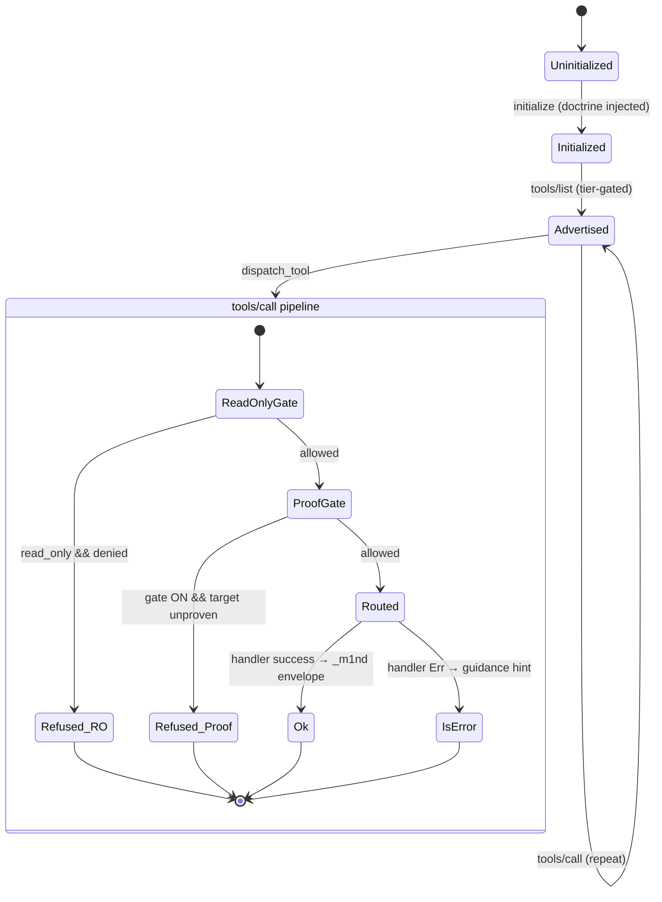

# m1nd-mcp-tool-surface-verb-budget

The MCP server's outward face: a static 117-verb catalog advertised through a two-tier verb-budget gate (41 essential vs 117 full), dispatched by a name-matched router to per-verb handlers, wrapped by injected `M1ND_INSTRUCTIONS` doctrine, a host-binding tool-surface contract, and read-only / proof-gate write guards.

## Class/Component



## Sequence



## State/Flow



## Invariantes
- Catalog size == 117: `all_tool_schemas_inner()` has exactly 117 top-level `"name"` entries (server.rs:505-2597; verified in-session: grep of 8-space-indent names = 117; the 2 extra `"name"` hits are nested inside inputSchemas).
- Tier gate trims **advertisement only**, never handler existence: hidden verbs stay registered and callable (tests `all_tool_schemas_always_contains_all_tools_regardless_of_tier` :7352, `tier_gate_full_advertises_all_tools` :7270). Essential is a strict subset.
- Unrecognized `M1ND_TOOL_TIER` → the CORE menu, never full: `active_tool_tier()` matches only `"full"`, so a typo in an operator env fails closed on the SMALL surface (test `tier_gate_unrecognized_value_falls_back_to_core`).
- The served menu == `core_menu_tool_names()` == `CORE_TOOLS` ∪ `HOST_BINDING_REQUIRED_TOOLS` — DERIVED, never a second hand-typed list, so it cannot drift from the host-binding contract it has to satisfy (tests `core_menu_serves_exactly_the_ratified_core_plus_the_binding_floor`, `tier_gate_default_advertises_only_the_core_menu`). The historical `"essential"` token still resolves here.
- Menu size ≤ `CORE_MENU_MAX` (20; 15 served today) — the mechanical form of the owner's "the menu must fit on one screen". The bound itself is guarded at COMPILE time (`const _: () = assert!(CORE_MENU_MAX < 30)`).
- Every `CORE_TOOLS` name exists in the registry — a typo would silently shrink the menu (test `core_menu_stays_within_its_stated_bound`).
- The core menu carries its own map: `annotate_core_menu_discovery` appends the `[CORE MENU]` line to the `help` description with a COMPUTED hidden count, so verb #143 keeps the sentence true (test `core_menu_carries_the_line_that_leads_to_the_rest`).
- **The session card.** Every session pays for the `instructions` and the default `tools/list` before its first call (24,179 + 24,036 characters until 2026-11-20). `M1ND_INSTRUCTIONS` is now an operating card (≤ 6,000 characters: the loop north → seek → impact and its `co_change`, honest answers, reception and the write laws, `graph_drift` and its refresh call, the door, the voice cadence), and the core and investigate tiers serve each core verb through `core_menu_card_schema`: a `CORE_MENU_CARDS` description (with the POLICY-DISABLED mark derived by `menu_floor_gate_prefix`) and an input schema stripped of `description`/`default` by `strip_schema_prose`, so names, types, enums, `required` and `additionalProperties` are unchanged. `tools/list` ≤ 10,000 characters, ≤ 1,200 per tool, measured as default `json.dumps` renders it (test `tests/session_card_budget.rs`, real binary over stdio). The full tier and the registry are untouched.
- What left the push surface is served on pull. `help {topic: "<id>"}` opens one of fifteen doctrine cards in `help_topics.rs` (reception, menu, authority, north, recall, verdicts, capture, promotion, telemetry, delegate, missions, soul, write_surface, voice, verbs): the former instruction paragraphs, moved word for word (test `every_help_topic_is_served_by_help`; the card's pull line names every id, test `the_instructions_name_every_help_topic`). `help(tool_name)` in full render serves the registry description ("In full"), every optional parameter with its default and description, and the fields of object-shaped parameters (`claims[].evidence`) — everything a menu card leaves out (test `core_menu_serves_a_card_and_help_serves_the_rest`; floor marks on the cards, test `core_menu_cards_keep_every_floor_gate_mark`).
- `full_registry_tool_count` in health is COMPUTED live from the schema array (tools.rs:3269) — self-corrects to 117 despite nearby "102" doc comments.
- `minimum_safe_tool_count` is the REQUIRED-verb floor (`HOST_BINDING_REQUIRED_TOOLS.len()` = 8), NOT total registry — deliberately so tiering never falsely reads as degraded.
- `degraded_host_tool_surface` fires iff any `AGENT_TRUST_REQUIRED_TOOL` (7) is missing from host-reported `available_tools`; a count-only handshake never invents missing tools (test :6291).
- read-only attach refuses every listed mutating verb BEFORE any side-effecting tick (read_only gate is first in dispatch_tool :3932); `delegate` is intentionally ABSENT from the denylist (it is read-only, ambient-legal).
- proof gate (when ON) treats an empty/unresolvable target set as unproven → refuses (:3957).
- tools/call handler errors surface as `isError` content, not JSON-RPC errors (MCP spec, :4816).
- `resonate` is a handler-only back-compat verb: dispatchable (:4226) but ABSENT from every advertised tier (test `resonate_schema_absent_from_all_tiers_after_surface_removal` :7391).
- **The honest front door.** No agent-facing direction names a verb its reader cannot call. `help` routes, overview cards, recovery hints, runtime error hints, `help(tool_name)` next lists, `_m1nd.suggest_next`, mission starter/next moves and the empty-history notes of `tremor`/`predict` are judged against the M1ND-10 floor table — the one `enforce_generic_action_policy` enforces — by the `help_guidance::front_door_oracle` battery (`*_name_only_verbs_a_generic_caller_can_call`, `*_name_only_callable_verbs`). A verb counts as callable when one of its actions sits at ORDINARY or is an action-keyed generic admission (today only `ingest {mode: "refresh"}`); an example call is judged by the gate itself. Next lists and `suggest_next` are also FILTERED at runtime through `server::generic_caller_reaches`, so a verb whose floor rises drops out without an edit. Orientation routes to `north`, never `audit`; document work routes to `document_resolve`/`document_bindings`/`document_drift`, never `ingest {mode: "merge"}`.
- A verb's own runtime error routes to `help(tool_name=<verb>)`, not `trace`: `trace` is for failure text from the caller's program (test `a_verb_error_routes_to_the_verb_contract_not_to_failure_triage`).
- `help` refuses an argument outside its published input schema and names the closest accepted key (`tool` → `tool_name`) instead of silently answering the overview (test `help_rejects_an_unknown_argument_and_names_the_one_it_meant`).
- `_m1nd.read_only` is `true` when the owner is attached read-only OR the catalog records the call as a pure read (every effect `Read`): `health`, `help`, `search`, `view`… Nominal reads catalogued with plasticity or counters (`seek`, `activate`) stay `false` (test `response_envelope_marks_pure_reads_read_only`).
- `evidence_query` accepts `agent_id` like every verb and still records no presence (test `owner_query_accepts_agent_id_like_every_other_verb_and_stays_read_only`).
- **The clean wire.** No tool response carries an ANSI escape: tool results are read by agents, and an escape inside JSON reaches them as `\u001b[...m` noise. `personality.rs` has no colour palette and `help` renders plain text without decorative borders; no human CLI path in the crate renders tool output. Test `no_menu_verb_puts_an_ansi_escape_on_the_wire` calls all fifteen menu verbs through MCP `tools/call` on a real-source fixture and checks raw and JSON-escaped forms.
- `help` says each statement at most twice: once in the plain `formatted` rendering, once in the structured `guidance`. It lifts only `proof_state` and `next_suggested_tool` to the top level; `next_step_hint`, `why_this_next_step`, `what_is_missing`, `next_suggested_target` and `confidence` live in `guidance` (`next_step`, `why`, `missing_context`, `confidence`) and are not restated (test `help_does_not_repeat_the_same_text_three_times`).

## Gaps
- **[medium] No parity/drift-guard test** between advertised catalog (122), the dispatch table, and `ESSENTIAL_TOOLS`. A verb can be added to one and forgotten in another with green CI. Live drift PRESENT: 5 `lock_` verbs dispatchable (server.rs:5114-5162) but NOT in the 122-catalog; `resonate` dispatchable-but-uncatalogued (by design).
- **[medium] `lock_` verbs are invisible verbs**: callable via tools/call but never advertised in ANY tier (not even `full`). `schema_tools()` now reads `all_tool_schemas()`, so `help` covers every REGISTERED verb — but the `lock_` family is not in the registry at all, so it remains unreachable by `help`/`find_similar_tool_names`. Fixing it means registering the schemas, not widening help.
- **[low] `help` + fuzzy suggestion saw only the advertised tier** — **CLOSED 2026-08-01**: `schema_tools()` reads `all_tool_schemas()`, so `help` and the did-you-mean matcher catalog the FULL registry at every tier (test `help_sees_every_verb_regardless_of_tier`). The gap was low severity while the default menu was 48; shrinking it to a core of 15 made `help` the door and promoted this to load-bearing.
- **[low] Stale count literals** — **CLOSED**: docstrings now state the registry-derived counts (122 full / 42 essential — the F0a slice-2 landing added the four system-blocks verbs).
  Original finding: in doctrine-adjacent comments: "all 102 tools" (server.rs:423,465,504 — confirmed in code read), "expose all 102 tools" (tools.rs:3301), "curated ~25 tools" for the 41-entry const (server.rs:367). Live values are correct; only the human-readable comments mislead.
- **[low] `session_handshake` degraded verdict trusts the caller**: the server cannot independently see which subset the host injected (non_claim, tools.rs:3323-3326). A host that omits verbs but passes no `available_tools` yields a false "ok".
- **[low] Naming hazard — two "budgets"**: the verb budget (tier gate) and the result token budget (result_shaping) are orthogonal; the token estimate is chars/4, explicitly NOT real BPE (result_shaping.rs:114), so packed budgets can drift.
```
