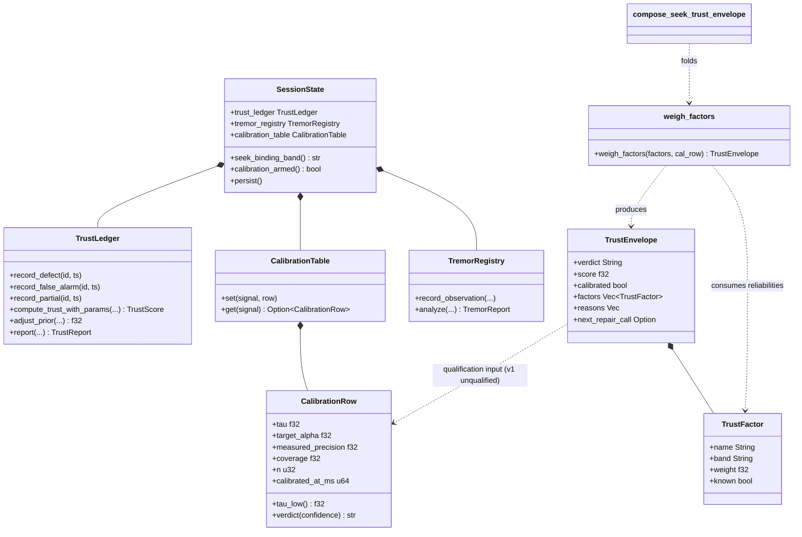
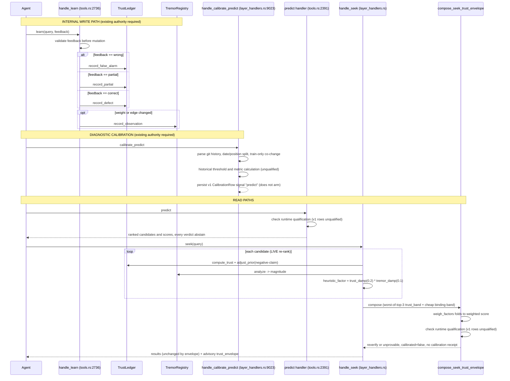
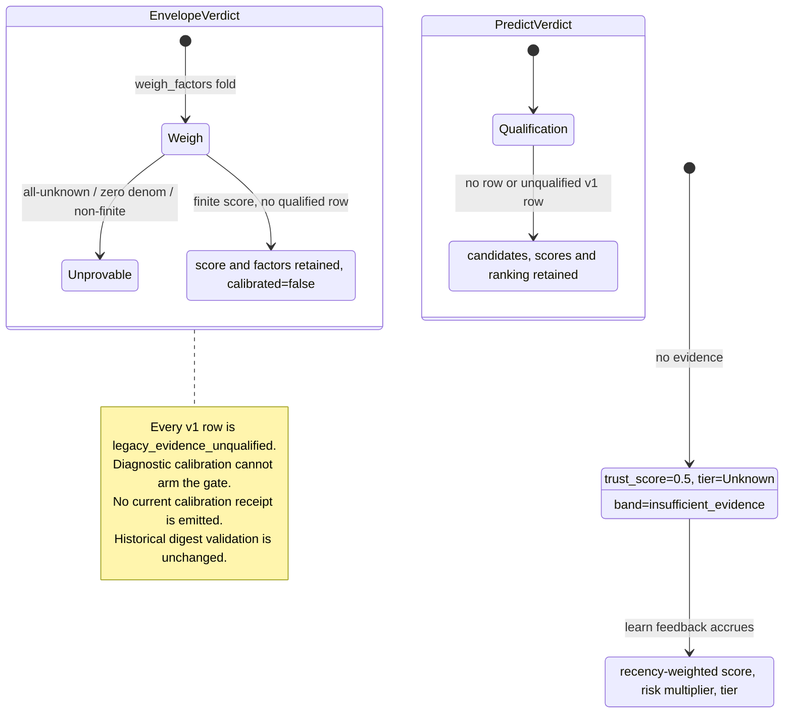

# Trust & Calibration

A defect-history actuarial ledger + tremor detector feed a live multiplicative re-rank of seek results. The v1 calibration table is retained for diagnostics and persistence compatibility, but every row is `legacy_evidence_unqualified` for runtime decisions. Prediction abstains; the advisory seek trust envelope keeps its weighted score and stays at `reverify` or `unprovable`. Running `calibrate_predict` or `calibrate_envelope` does not enable `act`. See [the qualification boundary](../CALIBRATION-QUALIFICATION.md).

## Class

## Sequence

Internal WRITE paths below retain their historical feedback interpretation and diagnostic row format. Generic public `learn` and calibration routes remain policy-disabled; this diagram does not grant access. READ paths retain prediction ranking, seek live re-rank, and the advisory envelope, but all v1 rows fail runtime qualification.

## State/Flow

Runtime qualification is separate from row presence and structural validation. No current v1 row can reach `act`, including a row just persisted by a diagnostic handler. The serialized verdict vocabulary and historical digest validation remain compatible; they do not establish a current qualified state.

## Invariantes

- Cold start with no evidence to trust_score=0.5, tier=Unknown, risk_multiplier=1.0, band=insufficient_evidence (never a bare 0.5 quoted as confidence) (trust.rs:266-287, l78-85).
- trust_score clamped GE 0.05 (never 0); risk_multiplier capped at RISK_MULTIPLIER_CAP=3.0 (trust.rs:304-307).
- Recency decay: old defects decay toward RECENCY_FLOOR=0.3 (never to zero) — an old bug still contributes 30% (trust.rs:301).
- adjust_prior clamps to [0.0, PRIOR_CAP=0.95]: positive claims scaled by trust, negative claims by risk_multiplier (trust.rs:499-518).
- v1 thresholds and metrics are diagnostic values, not evidence that a live signal satisfies an error budget. No threshold value, including tau=1.0, qualifies a row.
- Missing rows and unqualified v1 rows cannot arm runtime decisions: every prediction verdict abstains; the envelope is `reverify` or `unprovable`, `calibrated=false`, with no current calibration receipt.
- Structural validation and historical receipt digest validation remain compatible. Neither check promotes a row to qualified evidence; valid v1 persistence still round-trips unchanged.
- Anti-AND: a single red factor does NOT force abstain when the weighted majority is clean (weighted fold, not any-red conjunction) (trust_envelope.rs weigh_factors).
- known:false factors drop from BOTH numerator and denominator; all-unknown / zero denominator / non-finite score to unprovable, score=0.0 (never a fake number) (trust_envelope.rs:120-164).
- Non-finite / negative / zero-weight factors are skipped rather than poisoning the fold into NaN (trust_envelope.rs:126-131).
- Calibration persistence remains atomic (temp+rename), versioned, and structurally validated. The containment does not rewrite valid historical rows on load (calibration.rs).
- Tremor magnitude capped at MAGNITUDE_CAP=100.0; nodes below MIN_OBSERVATIONS_FOR_ACCELERATION=3 (after gap-dedup) skipped; ring buffer bounded at 256 (tremor.rs:286-335).
- Tremor registry keyed by stable external_id so it survives ingest mode=replace (tremor.rs:157-162).

## Gaps

- **[high]** Evidence qualification is open. The diagnostic calibration writers persist rows, but row presence, threshold arithmetic, and reported metrics do not establish a statistical error bound. All v1 rows are contained as `legacy_evidence_unqualified`; running either writer cannot enable `act`.
- **[medium]** The trust envelope is DARK/advisory — attached to SeekOutput but does not gate or alter results; an agent must voluntarily honor it (protocol/layers.rs:147-148; layer_handlers.rs:904).
- **[medium]** Evidence supply is entirely manual: the only production writer of ledger + tremor is handle_learn; the daemon does not autonomously record defects/tremor. With no learn traffic every node stays cold-start, so trust/tremor contribute ~nothing to re-rank (all other record_* sites are #[cfg(test)]).
- **[medium]** Envelope diagnostics use trust-band reliability values, while the runtime envelope combines several weighted factors. Sharing a numeric range does not qualify the evidence or establish that the diagnostic corpus represents the runtime decision. The current containment makes no such claim.
- **[low]** Stale doc comment: tremor.rs:180 says record_observation is called from handle_learn AND handle_activate, but handle_activate does not call it (tools.rs:918+).
- **[low]** seek_binding_band can only return needs_ingest or full_trust, so the degraded/stale_binding bands (reliability 0.15) that binding_reliability supports are never exercised on the seek path — a genuinely degraded host is invisible to the seek envelope (session.rs:706-716).
- **[medium]** Feedback interpretation remains unchanged: valid `correct` feedback records a defect and `wrong` records a false alarm. Relevance feedback is not independently verified defect evidence; qualification remains open. Invalid feedback is rejected before mutation (`tools.rs::handle_learn`).

## Proof gaps (from map proof_missing)

- Runtime containment must hold before and after diagnostic calibration, persistence/reload, and current receipt projection: no v1 row may enable `act`. A synthetic test that previously reached `act` is not statistical qualification.
- The invalid-feedback regression checks rejection before mutation; it does not qualify the meaning of valid feedback as defect evidence.
- No end-to-end learn to seek test asserting accrued defects/tremor actually change seek result ORDER.
- No test that the seek envelope observes a DEGRADED binding on the seek path specifically.
- No calibration-drift/recalibration test (calibrated_at_ms stored, staleness never asserted).
- No independent qualification of the threshold, labels, held-out evaluation, or correspondence between diagnostic and runtime scores is established by this containment.
- No concurrency/property test on ledger/registry under interleaved learn writes + seek reads.

## MCP verbs

learn (internal feedback write path; public generic route policy-disabled) - trust - tremor - predict (ranked candidates; verdicts abstain) - calibrate_predict (git-history diagnostics; does not arm) - calibrate_envelope (ledger diagnostics; does not arm; `envelope_uncalibrated` when no corpus) - seek (live re-rank + advisory envelope at `reverify` or `unprovable`) - trust_selftest (binding self-check). Calibration authority floors remain unchanged.
